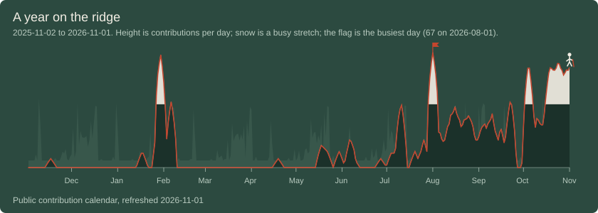

<!-- pinned:start -->
<a href="https://vekhyat.github.io/portfolio/"><picture><source media="(prefers-reduced-motion: reduce)" srcset="./dist/static/header.svg"></picture></a>

<a href="https://github.com/vekhyat/SatQuery-AI"><picture><source media="(prefers-reduced-motion: reduce)" srcset="./dist/static/card-1.svg"></picture></a>
<a href="https://github.com/vekhyat/Auralis"><picture><source media="(prefers-reduced-motion: reduce)" srcset="./dist/static/card-2.svg"></picture></a>
<a href="https://github.com/vekhyat/git-guide"><picture><source media="(prefers-reduced-motion: reduce)" srcset="./dist/static/card-3.svg"></picture></a>
<a href="https://github.com/vekhyat/agent-hub"><picture><source media="(prefers-reduced-motion: reduce)" srcset="./dist/static/card-4.svg"></picture></a>

<!-- pinned:end -->

I'm Vekhyat. I build things to understand the maths and systems underneath them: a food-label scanner for phones, small tools for my Linux desktop, and a satellite-imagery project with a team. Lately I'm reading about theoretical computer science and programming languages.

The cards above are my pinned repositories. They redraw themselves every day from whatever I have pinned, so they are always current.

You can find me on my [portfolio](https://vekhyat.github.io/portfolio/) and [LinkedIn](https://www.linkedin.com/in/vekhyat-jain-562776364), or write to [vekhyatjain123@gmail.com](mailto:vekhyatjain123@gmail.com).

## More work

- [Ingradient](https://github.com/vekhyat/ingradient) scans a packaged food's barcode or label and gives a sourced assessment of what's in it. OCR runs on the phone, and your history stays encrypted on the device.
- [SatQuery AI](https://github.com/vekhyat/SatQuery-AI) answers questions about satellite imagery: change over time, optical against SAR, with a trace of how each answer was reached. A team project for an ISRO problem statement.
- [Auralis](https://github.com/vekhyat/Auralis) searches for music and downloads lossless audio from a streaming link, in a Go and Wails desktop app. Built on [SpotiFLAC](https://github.com/afkarxyz/SpotiFLAC).
- [Git Guide](https://github.com/vekhyat/git-guide) is a visual, offline guide to everyday Git: commands, branches, remotes, and undo.

## Small desktop tools

- [omarchy-swipe-switcher](https://github.com/vekhyat/omarchy-swipe-switcher) switches windows with a three-finger swipe and shows live previews.
- [quota](https://github.com/vekhyat/quota) shows Claude, Codex, and Grok limits, usage, and cost in the desktop bar.
- [agent-hub](https://github.com/vekhyat/agent-hub) lets a coding agent start helpers in visible terminals, hand them tasks, and collect their reports.

## Lately

<picture>
  <source media="(prefers-reduced-motion: reduce)" srcset="./dist/static/lately.svg">
  
</picture>

<picture>
  <source media="(prefers-reduced-motion: reduce)" srcset="./dist/static/ridge.svg">
  
</picture>

All of this is refreshed daily by a workflow in this repository, from public data only.
