<picture>
  <source media="(prefers-reduced-motion: reduce)" srcset="./assets/static/header.svg">
  
</picture>

  <a href="https://vekhyat.github.io/portfolio/">Portfolio</a> ·
  <a href="https://www.linkedin.com/in/vekhyat-jain-562776364">LinkedIn</a> ·
  <a href="mailto:vekhyatjain123@gmail.com">Email</a>

### Curious about the theory. Building to understand it.

I'm Vekhyat, a **Data Science & AI undergraduate at Thapar Institute of Engineering & Technology**. I build mobile apps, desktop tools, and experiments, while learning the mathematics and systems underneath them.

**Currently exploring:** machine learning · theoretical computer science · programming languages · developer tools

## Selected work

<table>
<tr>
<td width="50%" valign="top">

### [01 / Ingradient](https://github.com/vekhyat/ingradient)
**Understand what's in your food.**

A mobile app for packaged-food barcodes and labels, with on-device OCR, reviewable facts, scientific source citations, and encrypted local history.

React Native · Expo · TypeScript · FastAPI

</td>
<td width="50%" valign="top">

### [02 / SatQuery AI](https://github.com/vekhyat/SatQuery-AI)
**Explore satellite imagery through queries.**

A team project for remote-sensing analysis, change detection, and optical/SAR comparison. Results pair visual evidence with a trace of the analysis.

Python · FastAPI · React · Rasterio

</td>
</tr>
<tr>
<td width="50%" valign="top">

### [03 / Auralis](https://github.com/vekhyat/Auralis)
**A desktop tool for lossless audio.**

Search music and fetch audio from streaming links in a Go and Wails desktop app. Built on SpotiFLAC, with upstream attribution preserved.

Go · Wails · Desktop development

</td>
<td width="50%" valign="top">

### [04 / Git Guide](https://github.com/vekhyat/git-guide)
**Make everyday Git easier to understand.**

A self-contained visual guide to commands, branches, remotes, and undo. Quick and detailed reading modes, with fonts included for offline use.

HTML · CSS · JavaScript · Learning tools

</td>
</tr>
</table>

## A little progress, every day

<picture>
  <source media="(prefers-reduced-motion: reduce) and (prefers-color-scheme: dark)" srcset="./dist/static/github-contribution-grid-snake-dark.svg">
  <source media="(prefers-reduced-motion: reduce)" srcset="./dist/static/github-contribution-grid-snake.svg">
  <source media="(prefers-color-scheme: dark)" srcset="./dist/github-contribution-grid-snake-dark.svg">
  
</picture>

A view of my public contribution calendar. Each square is a day of activity.

### Outside the editor

Learning **ML fundamentals, data structures, and mathematics**. Helping organise developer workshops and hackathons with **ACM Thapar**. Interested in how better tools can change the way we build software.

---

Explore a project. Ask a question. Build something useful.

