<picture>
  <source media="(prefers-reduced-motion: reduce)" srcset="./assets/static/header.svg">
  
</picture>

I'm Vekhyat. I study Data Science & AI at Thapar and build things to understand the maths and systems underneath them: a food-label scanner for phones, small tools for my Linux desktop, and a satellite-imagery project with a team. Lately I'm reading about theoretical computer science and programming languages.

You can find me on my [portfolio](https://vekhyat.github.io/portfolio/) and [LinkedIn](https://www.linkedin.com/in/vekhyat-jain-562776364), or write to [vekhyatjain123@gmail.com](mailto:vekhyatjain123@gmail.com).

## Work

<table>
<tr>
<td width="50%" valign="top">

### [Ingradient](https://github.com/vekhyat/ingradient)

Scan a packaged food's barcode or label and get a sourced assessment of what's in it. OCR runs on the phone, and your history stays encrypted on the device.

React Native, Expo, TypeScript, FastAPI

</td>
<td width="50%" valign="top">

### [SatQuery AI](https://github.com/vekhyat/SatQuery-AI)

Ask questions of satellite imagery: spot change over time and compare optical with SAR data, with a trace of how each answer was reached. A team project for an ISRO problem statement.

Python, FastAPI, React, Rasterio

</td>
</tr>
<tr>
<td width="50%" valign="top">

### [Auralis](https://github.com/vekhyat/Auralis)

Search for music and download lossless audio from a streaming link, in a desktop app. Built on [SpotiFLAC](https://github.com/afkarxyz/SpotiFLAC).

Go, Wails, TypeScript

</td>
<td width="50%" valign="top">

### [Git Guide](https://github.com/vekhyat/git-guide)

A visual, offline guide to everyday Git: commands, branches, remotes, and undo. Each topic has a quick explanation and a detailed one.

HTML, CSS, JavaScript

</td>
</tr>
</table>

## Tools for my desktop

I run [Omarchy](https://omarchy.org) and keep writing small things for it.

- [omarchy-swipe-switcher](https://github.com/vekhyat/omarchy-swipe-switcher) switches windows with a three-finger swipe and shows live previews.
- [quota](https://github.com/vekhyat/quota) shows Claude, Codex, and Grok limits, usage, and cost in the bar.
- [agent-hub](https://github.com/vekhyat/agent-hub) lets a coding agent start helpers in visible terminals, hand them tasks, and collect their reports.

## Contributions

<picture>
  <source media="(prefers-reduced-motion: reduce)" srcset="./dist/static/github-contribution-grid-snake.svg">
  
</picture>

Refreshed daily by a workflow in this repository, from public data only.

Away from the keyboard I help organise developer workshops and hackathons with ACM Thapar.
